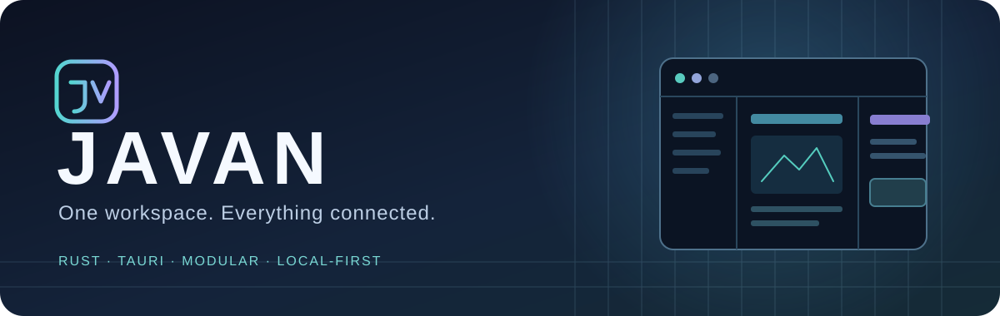
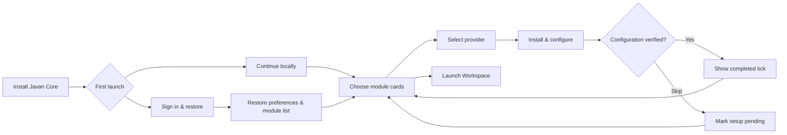
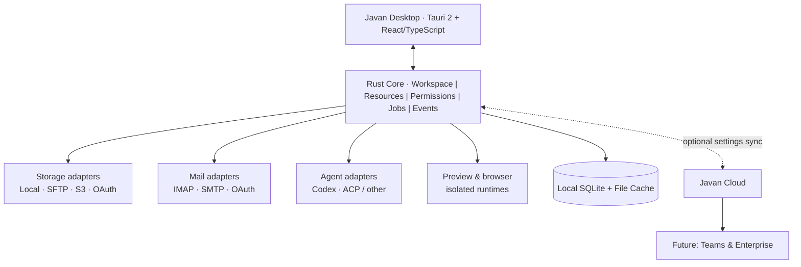

<div align="center">



# JAVAN
### One workspace. Everything connected.

**A modular, local-first AI desktop workspace for people, developers and teams.**

[](#project-status) [](#technology-direction) [](#technology-direction) [](docs/MODULES.md)

**[Vision](docs/VISION.md) · [Product presentation](docs/PITCH.md) · [Architecture](docs/ARCHITECTURE.md) · [Modules](docs/MODULES.md) · [Roadmap](docs/ROADMAP.md) · [Security](docs/SECURITY.md)**

**Product:** Javan · **Web:** [OpenJavan.com](https://openjavan.com) · **Brands:** Open Javan Labs & RedRoc Dev

</div>

---

> [!IMPORTANT]
> **Project status: concept / architecture phase.** This repository currently documents the intended product. No runnable Javan desktop application, cloud service or module registry is claimed here. Screens and flows described below are planned experiences.

## The idea

Your computer is full of disconnected places to work: a code editor, email accounts, local files, cloud drives, web previews, and AI assistants. **Javan brings them into a single flexible environment** while keeping users in control of which features they actually install.

```text
┌───────────────────────────────────────────────────────────────────────────┐
│ JAVAN  ◈   Projects    Cloud    Mail    Canvas    Search       Settings │
├──────────────────┬────────────────────────────────┬───────────────────────┤
│ EXPLORER         │ WORKSPACE / CANVAS             │ AI AGENTS             │
│ ▾ Projects       │                                │ Codex ▼               │
│   ▾ my-project   │   Live website preview         │                       │
│     src/         │   Code • Diff • Documents      │ Plan → Edit → Test    │
│     package.json │   Email • Images • Files       │                       │
│ ▾ Local drives   │                                │ Pending approvals     │
│ ▾ Cloud storage  │   [Editor] [Preview] [Split]   │ Files changed: 3      │
│ ▾ Mailboxes      │                                │                       │
├──────────────────┴────────────────────────────────┴───────────────────────┤
│ Local-first   ● Connected        Workspace: Personal          main ⎇    │
└───────────────────────────────────────────────────────────────────────────┘
```

*Conceptual layout; not a screenshot of working software.*

## One application. Modules you choose.

| First-class area | What it unlocks |
|---|---|
| **AI Agents** | Codex first; interchangeable agent adapters and inspectable task approvals |
| **Email** | Unified inboxes, multi-account sending, downloaded local mail and search |
| **Cloud & Server Storage** | Local disks, S3/Wasabi, SFTP, Google Drive, OneDrive |
| **Browser Canvas** | Live website previews, split panes and optional isolated automation |
| **Developer Tools** | Monaco editor, terminal, diffs and project management |
| **Search** | Fast local search with carefully scoped access across connected resources |
| **Javan Sync** | Restore modules, layouts, settings and non-secret connection metadata on new devices |
| **Javan Teams** | Future shared workspaces, multi-agent workflows, approvals and audit trails |

## A better first-run experience



Choose an AI agent by its logo, configure it, save, and return to the module grid with a completion tick. Do the same for email, cloud storage, or nothing at all. **No forced cloud account. No forced integrations.** See [module and onboarding design](docs/MODULES.md).

## Product architecture at a glance



**Small native core + signed releases + optional compatible modules.** Modules that need new native privileges or cannot safely run in isolation will require a core release. Javan will never load arbitrary unsigned native code merely because GitHub hosts it.

## Why Rust + Tauri?

- Shared core services with platform-specific adapters rather than separate products for each OS.
- Native system integration without requiring the app to ship a whole Chromium browser for its basic UI.
- React/TypeScript for a polished, resizable desktop experience.
- A deliberate dependency budget: users install only the modules they choose.
- Linux/Zorin OS first; Windows and macOS after validation.

## Project status

| Area | Current state |
|---|---|
| Product vision and positioning | 📘 Documented |
| Desktop UX and onboarding | 📐 Designed conceptually |
| Rust/Tauri implementation | ⏳ Not started in this repo |
| Signed update and module registry | ⏳ Planned |
| Codex, mail, storage and browser integrations | ⏳ Planned |
| Javan Sync and Teams | ⏳ Future milestones |

See the [roadmap](docs/ROADMAP.md) for proposed milestones and acceptance criteria. They are **targets, not release promises**.

## Explore the project

| Document | What you'll find |
|---|---|
| [Vision](docs/VISION.md) | Problem, audience, values and product principles |
| [Pitch / presentation](docs/PITCH.md) | Slide-by-slide presentation of the idea and opportunity |
| [Architecture](docs/ARCHITECTURE.md) | Rust crates, adapters, boundaries, diagrams and data flows |
| [Modules and onboarding](docs/MODULES.md) | Module lifecycle, catalog, setup flows, signatures, permissions |
| [Product UX](docs/EXPERIENCE.md) | Three-pane UI, workspace profiles, new-device restore |
| [Roadmap](docs/ROADMAP.md) | Incremental delivery and objective exit criteria |
| [Security](docs/SECURITY.md) | Threat model, agent permissions, sync and trust boundaries |
| [Contributing](CONTRIBUTING.md) | How to propose ideas and design changes |

## Brand

**Javan** is the product. **Open Javan Labs** is its proposed product studio identity, associated with **RedRoc Dev**. The domain **OpenJavan.com** is the intended home. Legal entity status, trademarks and domain registration should be independently verified before claiming formal status.

<div align="center"><sub>Designed to work locally. Built to expand carefully. Made for humans and their agents.</sub></div>
