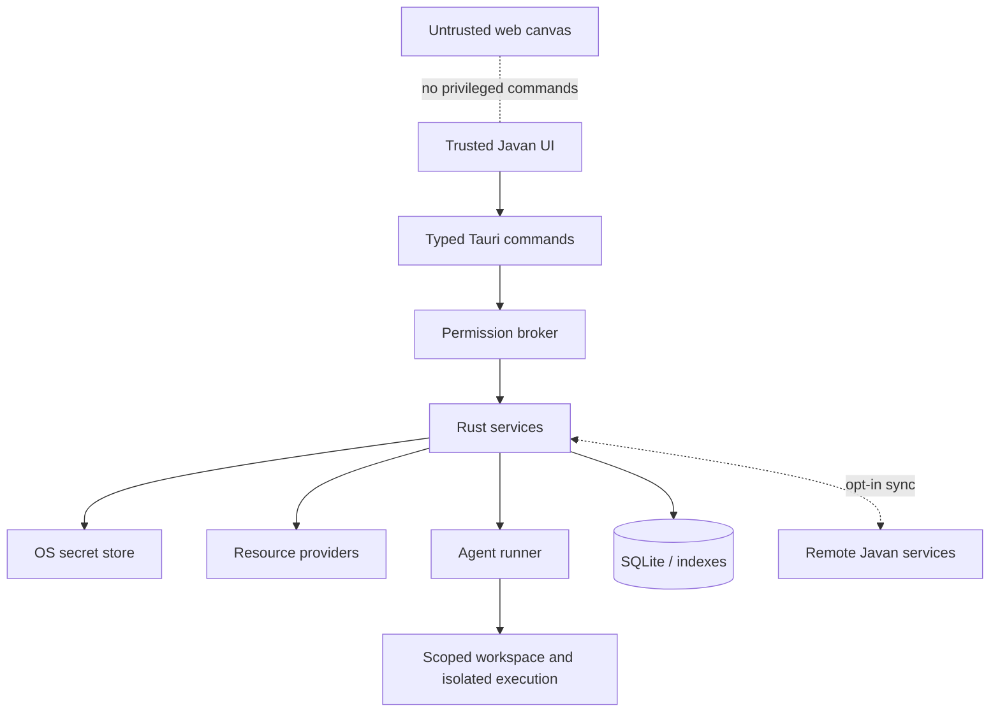
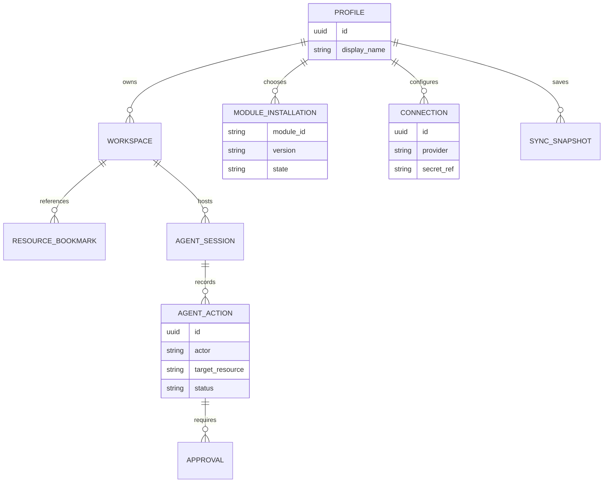

# Javan — Technical Architecture (proposal)

> Architecture decision baseline. No implementation is claimed.

## Stack
- **Rust** core, async services via Tokio.
- **Tauri 2** for platform windows and native integration.
- **React + TypeScript** frontend; Monaco for source editing; xterm.js with a restricted PTY bridge for terminals.
- **SQLite (WAL + FTS5)** for application state, indexes, jobs and metadata.
- **Platform secret stores** for credentials, with explicitly opt-in encrypted recovery.
- **S3 / SFTP / IMAP / SMTP / OAuth** via scoped provider interfaces.
- **Codex App Server** as the first planned agent backend; later ACP / other adapters.

## Trust boundaries


## Logical modules / Rust crates
```text
apps/desktop
crates/
  javan-core          # workspace, profile, command lifecycle
  javan-resources     # provider IDs, resource handles, capabilities
  javan-permissions   # grants, prompts, audit decisions
  javan-storage       # local/SFTP/S3 abstract interfaces
  javan-mail          # accounts, MIME, sync, drafts, sending
  javan-agents        # task orchestration and agent adapters
  javan-canvas        # preview lifecycle and isolation
  javan-search        # indexes and FTS5
  javan-jobs          # retries, transfer queue, background workers
  javan-sync          # versioned config diff/merge and crypto envelope
  javan-db            # migrations
modules/
  agents-codex/
  mail-imap/
  storage-s3/
  storage-sftp/
  canvas-preview/
```

## Resource addressing
Internal resource identifiers include provider, account scope, stable resource ID and capabilities. Human-readable examples (not operating-system URL handlers):
```text
local://workspace/my-project/src/main.ts
s3://wasabi/pixipics/images/banner.jpg
sftp://atlas/home/redroc/
mail://outlook/account-1/message-id
preview://workspace/my-project/app
```

Each provider declares supported operations (list, read, streaming write, copy, delete, search, versioning); Javan never assumes cloud object stores have local POSIX semantics.

## Module contract
1. Signed manifest declares publisher, version, API compatibility, supported platform/architecture, resource limits and requested permissions.
2. Resolver checks dependencies and compatibility **before** download.
3. Verified package is staged then atomically activated where supported.
4. Module processes receive only narrow capability handles; never unrestricted access to Tauri internals.
5. Sidecar processes may be used for native integrations. No arbitrary Rust dynamic libraries are loaded.
6. Core updates use signed application packages. Platform-specific/privileged changes require a new core release.

## Local database design (concept)


Secrets live outside the SQLite records; `secret_ref` is an opaque lookup key. Sensitive indexed messages and metadata need OS file permissions and encrypted backups.

## Browser architecture
Basic preview is isolated from privileged APIs. Optional automation uses a sandboxed browser sidecar rather than granting an arbitrary page Tauri command access. Linux uses WebKitGTK for native webviews; behaviour may differ from Chromium.

## Email architecture
Downloaded RFC 5322/MIME messages + account-specific metadata and search indexes. IMAP sync is separate from an optional archival retention policy. Sending is a privileged action with a confirmation step. OAuth tokens stay in secret storage.

## Agent integration
Agents request resources through a permission broker; selected email/file content sent to remote AI providers is separately disclosed and scoped. Code execution must happen in a constrained workspace where possible. Any permission to send mail, deploy or delete data is independently approved.

## Javan Sync
Default sync includes module IDs, compatible settings, preferences, layouts, bookmarks and non-secret connection descriptors. Credentials and user files do not sync by default. Future encrypted credential recovery uses user-held secrets, device revocation and explicit opt-in.

## Development and release
A versioned contract, build matrix for Linux / Windows / macOS, signed release assets, compatibility checks, rollout channels and repeatable migrations are prerequisites for production updates. Do not rely on GitHub checksums alone to authenticate arbitrary executable code.

## Architecture decision records to write before implementation
1. Sidecar isolation strategy
2. Module manifest schema and signing format
3. Linux installer format versus native updater
4. Profile and organisation ownership model
5. Sync conflict and restore semantics
6. User data retention after module uninstall
7. Browser preview threat model
