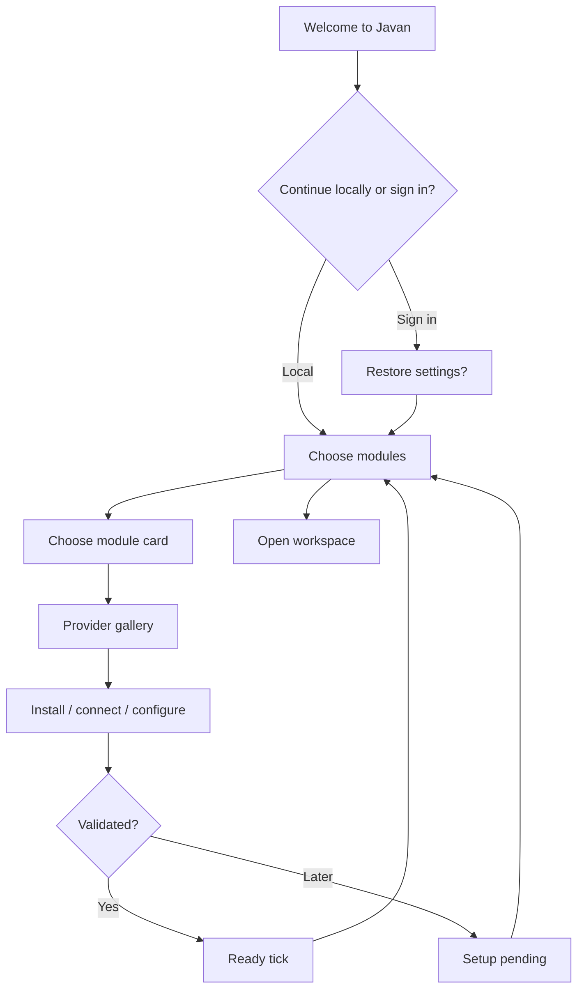

# Javan Experience Design

## Workspace anatomy
```text
┌───────────────────────── toolbar: Projects | Drives | Mail | Canvas | Modules ─────────────────────────┐
│ EXPLORER (resizable)     │ MAIN CANVAS (tabs, split views)        │ AGENTS (resizable)        │
│ Local disks              │ Code | Preview | Email | PDF           │ Task / plan / approvals  │
│ Cloud resources          │ Document / image / compare            │ Streaming results        │
│ Mailboxes                │ Optional bottom terminal & logs       │ Diffs and test outcomes  │
└──────────────────────────────────────── status · jobs · connections · git ────────────────────────────┘
```

## Core interactions
- Top toolbar launches resource-focused views without changing the user's whole layout.
- Explorer follows a provider-neutral tree, with badges for remote, cached and offline items.
- Centre workspace can hold multiple tabs, split vertically/horizontally and display a preview beside its code.
- Agent panel can be hidden or enlarged without losing context; every task is pinned to a specific workspace.
- Bottom job strip shows transfers, downloads, indexing, commands and module updates.

## First launch


## Cross-device restore
A new machine retrieves saved module selections and compatible layouts, previews required downloads and asks before installing. Connected services requiring device-specific authorisation are clearly marked **Reconnect needed**. Missing local paths become repairable bookmarks, never silently redirected.

## Usability & accessibility
Keyboard navigation, scalable UI, semantic labels, high-contrast themes, screen-reader support and reduced-motion settings are release requirements. Make transfer states and agent permissions understandable without jargon.

## Visual language
Calm, tool-focused, minimal. Clear borders, generous whitespace, unobtrusive status colours. First-party module tiles use distinctive icons/official provider branding where licenses permit. Avoid an overly decorative dashboard.

## Design goals (not measured yet)
- Core workspace useful without onboarding.
- No more than a few steps to select, connect and validate a common provider.
- No hidden side effects when enabling sync or agents.
- Full keyboard access to the explorer, canvas and agent panel.
