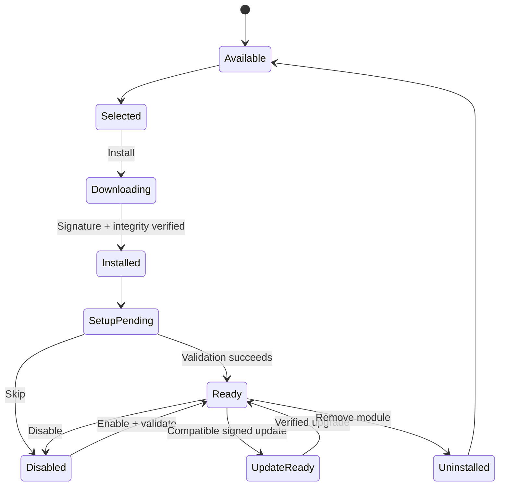

# Modules and Visual Onboarding

## The experience
The first launch shows cards such as **AI Agents**, **Email**, **Cloud Storage**, **Browser Canvas**, **Editor** and **Search**. Clicking AI Agents opens a provider gallery with recognizable logos and short descriptions. Select **Codex**, for instance, then install/authenticate, save and return to the main grid. A green check means configuration has been **validated**, not merely selected.

## First-party module catalogue (planned)
| Module | Example providers / tools | Setup |
|---|---|---|
| AI Agents | OpenAI Codex; future Claude Code / Gemini CLI | Agent runtime, login, scoped workspace |
| Mail | Gmail, Microsoft Outlook, Zoho, generic IMAP | Account auth, sync range, offline cache, send identity |
| Storage | Local files, Wasabi/S3, SFTP, Google Drive, OneDrive | Connection, authorization, resource grants |
| Canvas | Local preview, optional Chromium automation | Ports, isolation and automation permissions |
| Developer Tools | Monaco editor, terminal, Git tooling | Workspace paths, tool availability |
| Search | SQLite FTS5, later optional embeddings | Index roots and privacy choices |
| Teams (future) | Shared agent orchestration | Organisation, memberships, policies |

## Setup contract
Every module registers:
- catalogue metadata (publisher, purpose, screenshots/icons, compatibility);
- an install plan (artifacts, dependencies, network and disk estimates);
- setup steps with **Back**, **Skip** and **Save**;
- validation and health checks;
- enable / disable / remove operations;
- data retention policy and uninstall choices.

The onboarding grid remembers: `not_selected`, `selected`, `installing`, `setup_pending`, `ready`, `needs_attention`, `disabled`. Users can resume incomplete setup from the Module Library.

## Download and update safety
Module manifests and packages must be signed, versioned, checked against a trusted publisher root and downloaded over TLS. Hashes provide integrity but do not by themselves establish publisher trust. Sidecar/module permissions are enforced at runtime, not only displayed in a UI. No arbitrary dynamic libraries from GitHub are permitted.

Native dependencies that change Tauri privileges or need elevated OS installation are packaged through the signed desktop update path, or explicitly managed by the system package manager.

## Module vs. plugin
Modules are the **user-facing product concept**. An eventual third-party marketplace may call the same packages extensions internally, but the product language remains Javan Modules. External publishers are postponed until the module API, isolation and review process mature.

## Workspace profiles
Profiles (Developer / Office / Creative / custom) control which **installed** modules are visible and how panes are arranged. They do not duplicate downloads or automatically grant agents permission.

## Zero-module path
A user can skip every card and open a useful workspace with local files, tabs and settings. Javan must never require a commercial provider account to launch.
