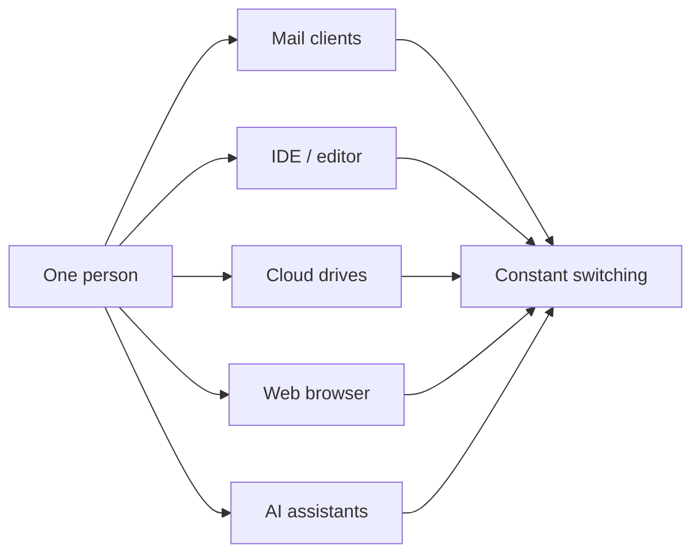
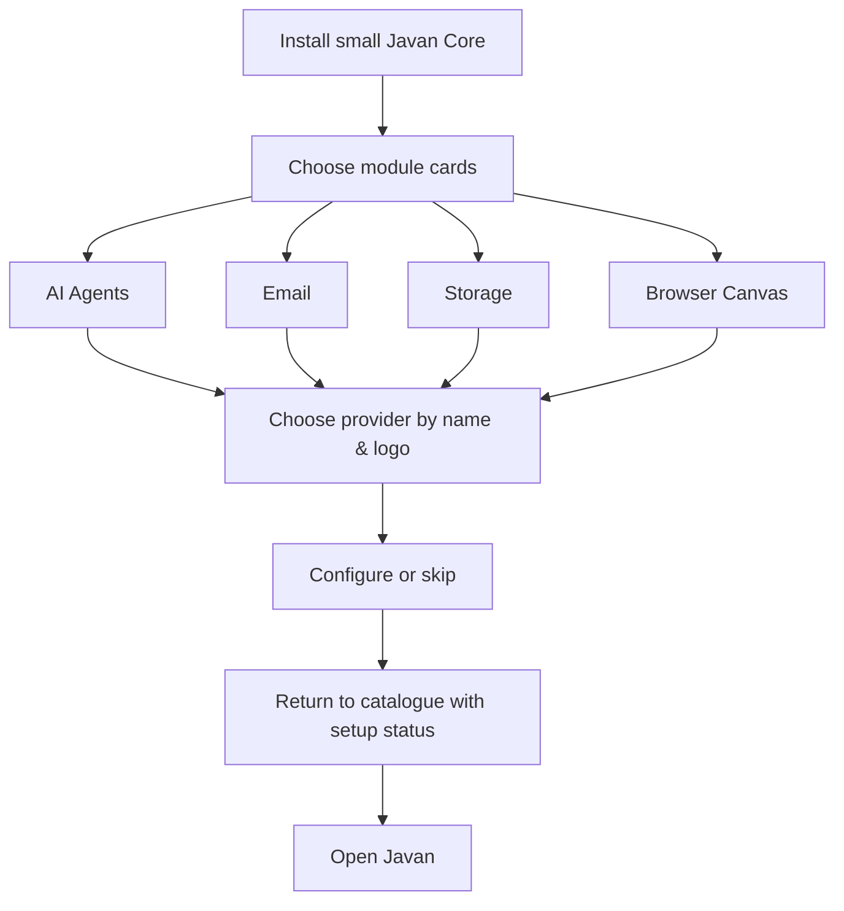
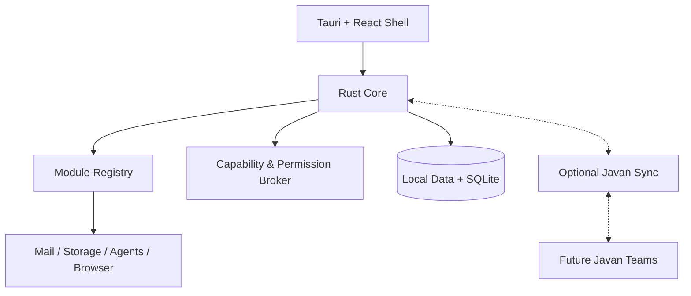
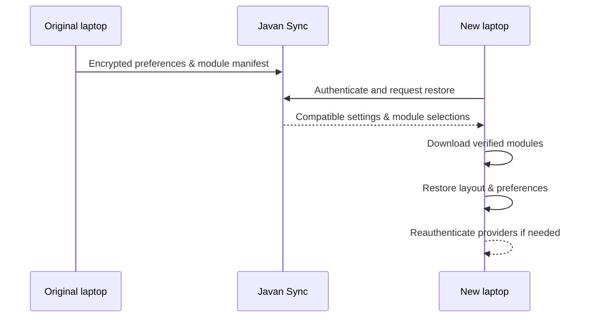
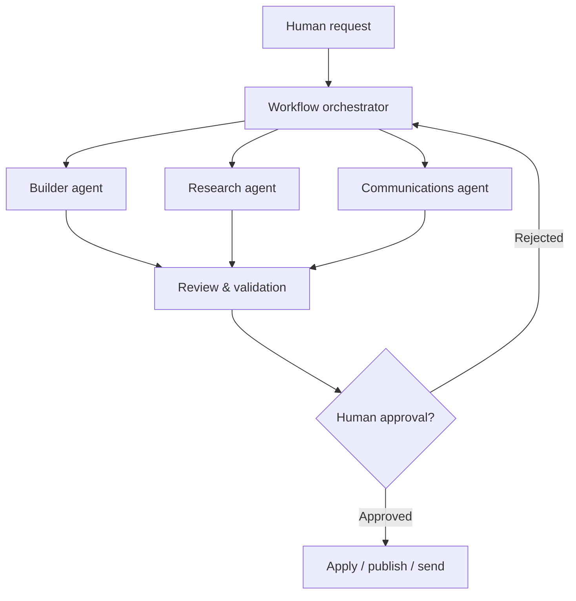
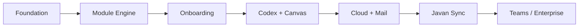

# JAVAN — Product Presentation
### A visual, slide-style overview for GitHub

> **One workspace. Everything connected.**  
> Product concept — not a product launch announcement.

---

## 01 · The opportunity
### Our digital work is scattered



Files, messages, previews and coding agents rarely share a common workspace or permission model.

---

## 02 · The thesis
### Bring the work to one canvas

```text
┌───────────────┬───────────────────────────┬────────────────┐
│ EXPLORER      │ CANVAS                    │ AI AGENT       │
│ Files         │ Code / Website / Email    │ Plan           │
│ Cloud         │ Images / Documents        │ Review         │
│ Mail          │ Split panes / Tabs        │ Execute        │
└───────────────┴───────────────────────────┴────────────────┘
```

**Javan is the workspace; modules provide capabilities.**

---

## 03 · Personalised by design
### Every install starts small



Optional account creation. Skip every module and start with an empty workspace.

---

## 04 · First-class capabilities
| 👩‍💻 Developers | 🗂 Everyone | 🏢 Teams (future) |
|---|---|---|
| Editor & terminal | File explorer | Shared workspaces |
| Codex & other agents | Unified email | Multi-agent task orchestration |
| Live browser canvas | Cloud & SFTP | Approval policies |
| Diffs & tests | Search & documents | Auditable work |

---

## 05 · The Javan architecture


Native core, optional integrations and a strict trust boundary.

---

## 06 · Own your experience
### Set up once. Recover anywhere.



No forced cloud account; raw local documents and credentials are **not** included in standard settings sync.

---

## 07 · AI teams, not black boxes


Human controls, resource scopes and an audit trail are part of the design.

---

## 08 · Sustainable release model
### Core, modules, optional cloud

| Layer | Distribution | Value |
|---|---|---|
| Desktop core | Signed native release | Reliable, fast local workspace |
| Modules | Verified, compatible packages | Install only what's useful |
| Javan Sync | Optional hosted service | Profiles and cross-device continuity |
| Javan Teams | Future business service | Shared work and coordinated agents |

Desktop updates and hosted service deployments remain independent.

---

## 09 · Delivery strategy


Each stage requires an independently testable working increment; features are not represented as implemented before they exist.

---

## 10 · The long game

**Javan Desktop** for a person. **Javan Modules** for their chosen tools. **Javan Sync** across their devices. **Javan Teams** for organisations that work alongside agents.

> The product begins as a lightweight, useful workspace—not a giant app that forces everything on everyone.

---

<div align="center">

# JAVAN
**One workspace. Everything connected.**

**Open Javan Labs × RedRoc Dev**

[View roadmap](ROADMAP.md) · [Explore architecture](ARCHITECTURE.md) · [Return to README](../README.md)

</div>
