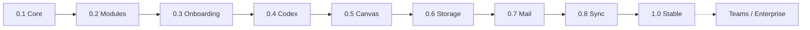

# Javan Roadmap

> This is a proposed delivery sequence, **not a schedule or implementation report**.

| Milestone | Delivery | Acceptance gate |
|---|---|---|
| **0.1 Desktop Foundation** | Tauri/Rust/React; resizable panes; local explorer; tabs; settings | Open, edit and save a local file; restore layout after restart |
| **0.2 Module Engine** | Signed manifest verification, registry, dependency planning, module states | Reject tampered/incompatible module; safe disable/uninstall |
| **0.3 Onboarding** | Module cards, provider gallery, skip/resume, readiness indicators | New user can start with zero modules, or complete provider flow |
| **0.4 Codex Module** | Agent connection, task events, scoped approvals, diffs | Agent makes a reviewable change within allowed workspace |
| **0.5 Canvas** | Live preview, split panes, isolated browser mode | Local project preview updates without exposing native APIs |
| **0.6 Storage** | SFTP + S3/Wasabi adapters, job queue and conflict handling | Download, edit and safely upload a file |
| **0.7 Email** | IMAP/SMTP + provider login, offline message store, unified inbox | Two accounts: receive, search offline and send from correct identity |
| **0.8 Javan Sync** | Optional identity, encrypted preferences sync, restore | Restore compatible module/layout settings on a second device |
| **1.0 Stable** | Cross-platform tests, migration/recovery, security hardening | Install, update, rollback where supported, recover from failures |
| **After 1.0 Teams** | Organisations, users, multi-agent tasks, review gates | Multi-user workflow with auditable permissions |
| **Later Enterprise** | SSO, policies, audit exports, self-hosting/managed options | Enterprise security review and operations criteria |

## Engineering guardrails
- A beautiful UI is not evidence that a provider integration works.
- Full ecosystem support is not necessary to demonstrate the core concept.
- Keep local mode independent of Javan Cloud.
- Preserve data across module updates and uninstall.
- Track platform-specific installation requirements.
- No unverified executable content from remote registries.

## Metrics to begin collecting once code exists
- Cold startup duration; installer size; idle RAM usage
- Percentage of successful first-run setups
- Module download and update error rates
- Time to complete a first agent task
- Mail and storage sync reliability
- Permission denial and approval audit coverage

Do not publish made-up completion percentages or benchmark numbers before measurements exist.
