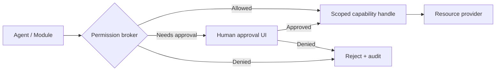

# Javan Security Principles

This document is a security design baseline. It is **not** an assertion that controls are implemented.

## Non-negotiables
1. **Local-first does not automatically mean private from an external AI provider.** Before transmitting selected messages/documents to a hosted model, disclose and enforce resource permissions.
2. The browser canvas is untrusted; loaded pages never gain unrestricted Tauri commands.
3. Credentials use platform secret stores. Standard Javan Sync must not upload raw SSH private keys, tokens or passwords.
4. All downloaded executable modules and app updates require publisher authentication and integrity verification.
5. Destructive actions, outbound email, deployments and bulk edits need explicit action-specific consent.
6. Every agent action records actor, scope, requested operation, outcome and time.

## Planned permission model

An installed module never inherently receives universal filesystem, email, terminal or network access. Read/write/send/deploy are separate privileges.

## Threat model
| Threat | Intended mitigation |
|---|---|
| Email prompt injection | Treat message content as untrusted; never turn mail text into privileged instructions |
| Malicious webpages | Isolated preview, no privileged IPC exposed |
| Compromised module download | Signed manifests/artifacts, allowlisted publisher keys, rollback |
| Exfiltration by an agent | Narrow resources, provider endpoints, explicit outbound-data policy |
| Dangerous filesystem traversal | Canonicalisation, symlink-aware scoping, safe path handling |
| Lost laptop | Full-disk encryption, OS keychain, revocable cloud sessions |
| Cloud compromise | Minimal metadata sync; optional client-side encrypted recovery |
| Cross-organisation data exposure | Tenant isolation and policy enforcement on every operation |

## Reporting
Until a dedicated security reporting channel exists, **do not post API keys, private data or exploit details in public issues**. The project must define private vulnerability intake before accepting third-party code or production users.

## Privacy default
No forced telemetry, no forced cloud account, no upload of documents/messages for indexing. Analytics, if introduced, must be documented with appropriate consent and retention controls.
